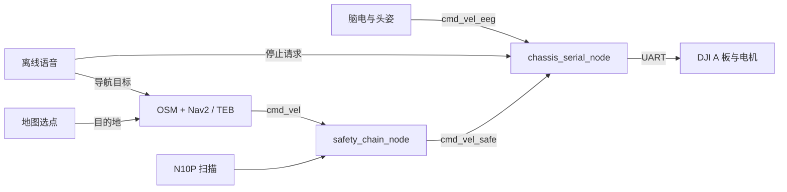

# 心语智行 · Smart Wheelchair

多模态自主导航轮椅全栈系统，2026 电赛英特尔杯 AI 专题作品。项目以 Intel Core Ultra DK2500 为端侧主机，在 ROS 2 Humble 上将脑控、离线语音与地图导航接入统一的底盘执行入口，并通过 PyQt5 提供三 Tab 交互界面。

本仓库收录上位机、导航、感知、交互与端侧推理源码。底盘电控固件由独立仓库维护，见[电控层与项目边界](#电控层与项目边界)。

| 项目组成 | 当前实现 |
| --- | --- |
| 交互入口 | 自主导航、小智陪伴、脑电控制三个 Tab |
| 核心软件 | 16 个核心 ROS 2 功能节点；完整启动还包含驱动、TF、RViz 等辅助进程 |
| 导航 | 离线 OSM 路网全局规划、Nav2 与 TEB 局部规划 |
| 端侧推理 | KWS、流式 ASR、TTS 与 YOLO，运行时不依赖云端服务 |
| 验证记录 | 99 项单元测试与 7 项振荡测试，合计 106 项自动化检查通过 |

## 目录

- [实物与界面](#实物与界面)
- [系统架构](#系统架构)
- [安全与失效处理](#安全与失效处理)
- [导航与脑控](#导航与脑控)
- [离线语音与视觉](#离线语音与视觉)
- [部署与验证](#部署与验证)
- [代码导航](#代码导航)
- [电控层与项目边界](#电控层与项目边界)

## 实物与界面

<p align="center">
  
  
  
</p>
<p align="center">轮椅正面 · 自制脑电采集帽 · 轮椅背面</p>

<p align="center">
  
  
</p>
<p align="center">自主导航：待命地图（左）与路径规划、RViz 联合视图（右）</p>

<p align="center">
  
  
</p>
<p align="center">小智陪伴（左）与脑电控制（右）</p>

## 系统架构

脑控输出短时运动意图，语音将识别结果转换为导航目标、停止请求或状态查询，地图导航生成连续速度指令。三条链路各自处理输入，底盘速度则由 [chassis_serial_node](src/rtk_perception/rtk_perception/chassis_serial_node.py) 统一选择并发送。PyQt5 界面通过 ROS 2 与服务节点交换消息，不直接写入电机串口。



| 输入链路 | 关键数据流 | 与底盘的关系 |
| --- | --- | --- |
| 脑控 | ADS1299 EEG、头部 IMU → 状态机 → `/cmd_vel_eeg` | 心跳有效且产生运动指令时临时接管 |
| 语音 | 麦克风 → KWS → ASR → 意图解析 | 发起导航、停止或状态查询，不直接发布电机速度 |
| 地图导航 | 地图终点 → OSM 全局路径 → Nav2/TEB → `/cmd_vel_safe` | 在导航门控和指令有效时持续控制 |

底盘仲裁顺序为串口启动静默期、强制停车、脑控临时接管、Nav2 导航。导航速度先从 `/cmd_vel` 经过 `safety_chain_node` 形成 `/cmd_vel_safe`；脑控的 `/cmd_vel_eeg` 则由底盘节点单独检查模式、指令时效和优先级。

## 安全与失效处理

### 心跳与控制权交还

脑控 Tab 以 1 Hz 发布 `/eeg_mode_active` 心跳。底盘节点检查其新鲜度；超过 3 s 未收到更新，就撤销脑控接管并回到 Nav2 模式。回退表示控制权交还，实际运动仍取决于有效导航目标、定位和速度指令；条件不成立时保持零速。Nav2 指令和脑控指令另有各自的过期归零逻辑。

### 三层安全约束

| 层级 | 实现 | 故障响应 |
| --- | --- | --- |
| 感知层 | N10P、LD14P、Gemini 扫描分别进入 costmap | 单路观测中断不阻断其他观测源 |
| 导航执行层 | `safety_chain_node` 以 20 Hz 读取 N10P 扫描并检查 Nav2 指令 | 0.3 m 内急停；扫描或指令过期时发布零速 |
| 串口与电控层 | 底盘节点统一编码发送，下位机保留看门狗 | 串口通信异常时维持停车状态 |

N10P 的 `/scan` 已过滤轮椅机身反射点。安全链直接订阅该路扫描，绕开三路融合输出和 Nav2 costmap；扫描与速度指令均按 0.5 s 时效检查。三路扫描仍分别写入 [local_costmap_params.yaml](src/rtk_perception/config/local_costmap_params.yaml)，不依赖融合节点才能完成导航避障。这里的“三路扫描”由两台物理激光雷达和一路 Gemini 深度相机生成的虚拟激光构成。

脑控速度不经过导航安全链，它由底盘节点的心跳、运动指令超时及优先级逻辑保护。串口看门狗属于下位机固件，未包含在本仓库内。

## 导航与脑控

### 离线路网与局部规划

[data/region.graphml](data/region.graphml) 是本地 OSM 路网，含 5,592 个节点和 12,802 条边。[networkx_planner_node](src/rtk_planner/rtk_planner/networkx_planner_node.py) 将起终点投影到邻近道路边，在本地图上计算路径；[path_to_baselink_node](src/rtk_perception/rtk_perception/path_to_baselink_node.py) 将路径转换到车体坐标系，再由 [path_feeder_node](src/rtk_perception/rtk_perception/path_feeder_node.py) 交给 Nav2 `FollowPath`。

局部规划从 VFH+ 迁移到 TEB，以降低狭窄通道与掉头时的方向抖振。单点 GNSS 的米级噪声由路径状态机处理：偏离路径超过 5 m 才进入接近路径模式，回到 4 m 内才恢复路径跟踪；拐角锁定避免在转弯处直接朝远处终点切线前进。


### 脑电与头姿控制

自制采集帽使用 ADS1299 八通道前额 EEG。脑控链路提取专注度特征，结合头部 IMU 的俯仰、侧倾与咬牙确认信号，由 20 Hz 控制状态机发布运动指令。持续专注、咬牙切换冷却与 EEG 冻结窗口用于减少误触发；头姿失联或指令过期时，底盘输出归零。

训练评估文件托管在[模型仓库](https://huggingface.co/lh527/smart-wheelchair/tree/main/models/eeg)。下图是专注度模型的离线交叉验证结果，不代表实地载人驾驶准确率。


<details>
<summary>查看五折交叉验证指标</summary>


</details>

## 离线语音与视觉

小智陪伴链路在本地完成关键词唤醒、流式语音识别、意图解析与语音合成。语音输入可以发起导航或停止请求，也可以查询状态；它不会绕过底盘仲裁直接发布电机速度。界面的摄像头、点云和语音面板对应同一套 ROS 2 感知与交互链路。

| 任务 | 当前实现 | 推理位置 |
| --- | --- | --- |
| 唤醒与识别 | sherpa-onnx Zipformer，关键权重为 INT8 | CPU |
| 语音合成 | Kokoro INT8，Piper 可作本地备选 | CPU |
| 目标检测 | YOLO11s OpenVINO IR，优先使用 INT8 权重 | OpenVINO 按 NPU → GPU → CPU 尝试加载 |

设备回退链由 [YOLO 推理引擎](third_party/ladar_ai/src/ladar_ai/yolo_engine.py)实现；语音模型由 sherpa-onnx 的 CPU 后端运行。所有模型均在设备本地推理，网络仅用于首次获取模型文件。

## 部署与验证

### 环境与模型

项目面向 Ubuntu 22.04、ROS 2 Humble 与 DK2500 的 16 GB 内存配置。真机还需要 ADS1299、头部 IMU、GNSS、车体 IMU、两台激光雷达、Gemini 深度相机、音频设备及底盘串口。ROS 2 主包位于 `src/`，TEB、雷达驱动和语音/视觉组件位于 `third_party/`。

大体积模型不随 Git 仓库分发。模型仓库的文件已经包含 `models/` 顶层目录，请在本仓库根目录下载，避免出现 `models/models/`：

```bash
python3 -m pip install -U huggingface_hub
hf download lh527/smart-wheelchair --local-dir .
```

当前视觉节点按 `models/yolo/yolo11s_openvino/yolo11s.xml` 查找模型，而模型仓库提供的 INT8 目录名为 `yolo11s_int8_openvino`。只下载该模型包时，可在本机为现有节点建立路径别名：

```bash
ln -s yolo11s_int8_openvino models/yolo/yolo11s_openvino
```

[source_env.sh](source_env.sh) 负责设置 `WS_ROOT`、`MODELS_ROOT` 并加载 ROS 2 与已构建的包。开发环境的启动入口为 [start/start_all.sh](start/start_all.sh)，默认选择实物底盘和车体 IMU；仿真底盘需同时关闭两项实物开关：

```bash
source source_env.sh
USE_REAL_CHASSIS=0 USE_REAL_IMU=0 ./start/start_all.sh
./start/stop_all.sh
```

当前公开源码快照依赖设备专用端口、模型及第三方构建环境；部分 Python 启动文件的工作空间路径初始化仍需校正。上述命令说明项目入口，不代表已完成全新机器上的一键复现。

### 验证记录

2026-06-25 的[自动化测试归档](tests/results/2026-06-25-teb/auto_test_result.txt)记录 99 项 `rtk_perception` 单元测试和 7 项振荡测试通过，合计 106 项。另有[硬件联调记录](tests/results/2026-06-25-teb/hardware_integration_test.txt)，覆盖雷达话题、TF、costmap 更新与仿真底盘响应；归档中也列明了当时尚待完成的端到端路径跟踪检查。这里的 106 项属于自动化验证，不等同于 106 次载人或硬件测试。

## 代码导航

| 路径 | 内容 |
| --- | --- |
| [src/rtk_perception](src/rtk_perception) | 三路扫描、局部路径、安全链、底盘仲裁及主 launch |
| [src/rtk_planner](src/rtk_planner) | OSM/NetworkX 全局规划 |
| [src/wheelchair_app](src/wheelchair_app) | PyQt5 三 Tab、脑控运行时、语音节点 |
| [src/rtk_gnss](src/rtk_gnss)、[src/rtk_imu](src/rtk_imu) | 定位与车体航向 |
| [src/rtk_map](src/rtk_map)、[src/rtk_frontend](src/rtk_frontend) | 离线地图瓦片与前端服务 |
| [third_party](third_party) | TEB、雷达驱动、ladar_ai、ai_model 组件 |
| [data](data)、[docs/images](docs/images) | 离线路网与项目实物、界面、架构图 |
| [tests/results](tests/results) | 自动化与联调记录 |

## 电控层与项目边界

本仓库负责上位机侧的 ROS 2、导航、交互和串口命令。DJI A 板上的 STM32 电机闭环与看门狗固件见[电控层仓库](https://github.com/Bit-Walker/KUST-RoboMaster-DJI-A-Board/tree/V2)。本项目是竞赛原型，尚未作为载人安全认证产品交付。

相关技术项目：[Nav2](https://github.com/ros-navigation/navigation2) · [TEB Local Planner](https://github.com/rst-tu-dortmund/teb_local_planner) · [OpenVINO](https://github.com/openvinotoolkit/openvino) · [sherpa-onnx](https://github.com/k2-fsa/sherpa-onnx)。

许可协议：[MIT](LICENSE)。
