# 心语智行 · Smart Wheelchair

**把脑电与头姿、离线语音、地图导航接入同一套轮椅控制系统。**

心语智行是面向 2026 电赛英特尔杯 AI 专题的多模态自主导航轮椅原型。项目以 Intel Core Ultra DK2500 为端侧主机，基于 ROS 2 Humble、Nav2 / TEB 和 PyQt5，将定位、感知、路径规划、交互与底盘指令仲裁贯通，提供「自主导航」「小智陪伴」「脑电控制」三个交互页面。

[部署指南](docs/getting-started.md) · [系统架构](#系统架构) · [验证记录](#验证与项目边界) · [模型资源](https://huggingface.co/lh527/smart-wheelchair/tree/main) · [MIT 许可](LICENSE)

> 本仓库包含上位机软件、导航、交互与端侧推理源码。底盘电控固件独立维护；完整运行依赖 ROS 2、模型文件和对应硬件。项目处于竞赛原型阶段，当前公开源码不等同于经过载人安全认证的产品。

## 实物与界面

<p align="center">
  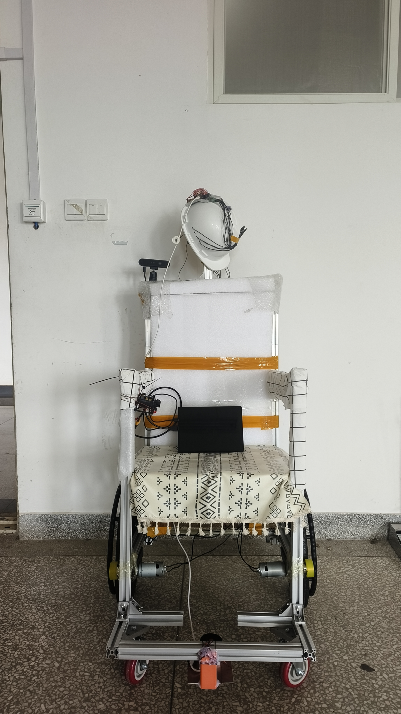
  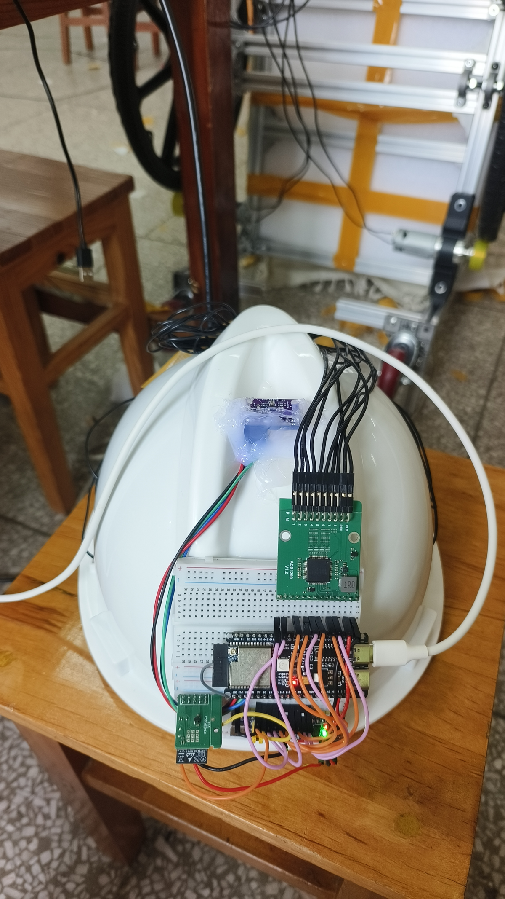
  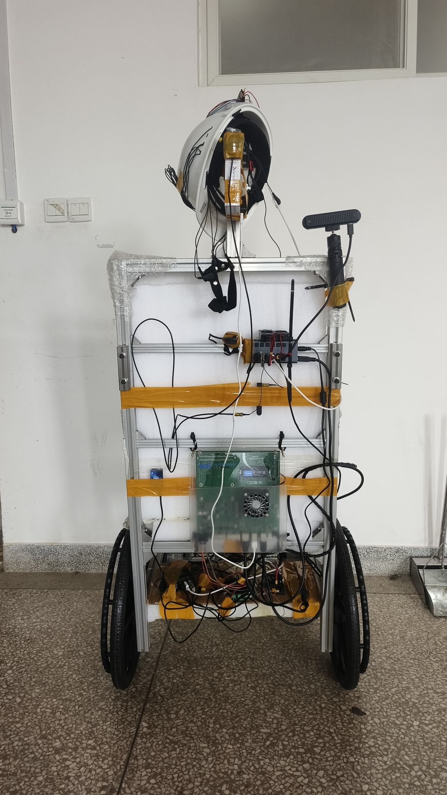
</p>
<p align="center">轮椅正面 · 脑电采集帽 · 轮椅背面</p>

<p align="center">
  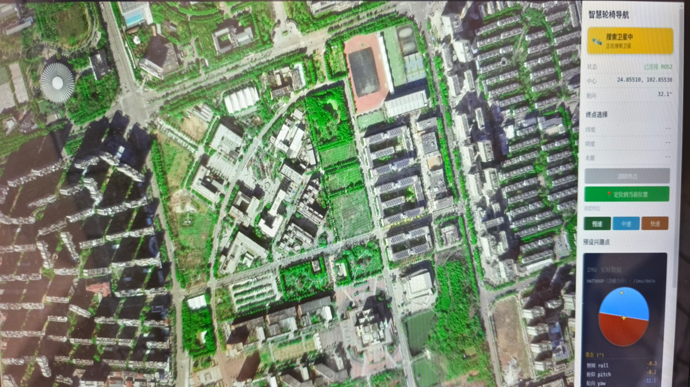
  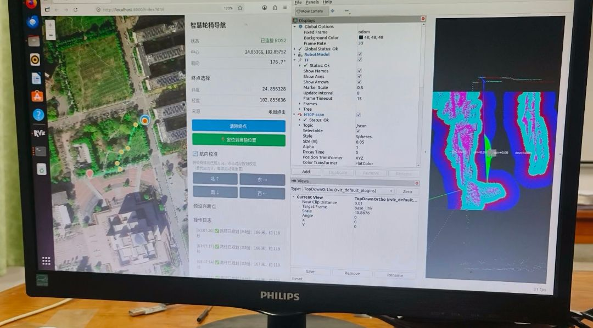
</p>
<p align="center">自主导航：地图选点、路径显示与 RViz 联合观察</p>

<p align="center">
  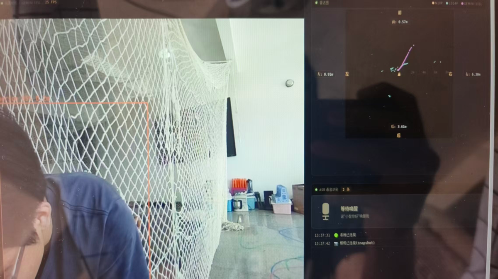
  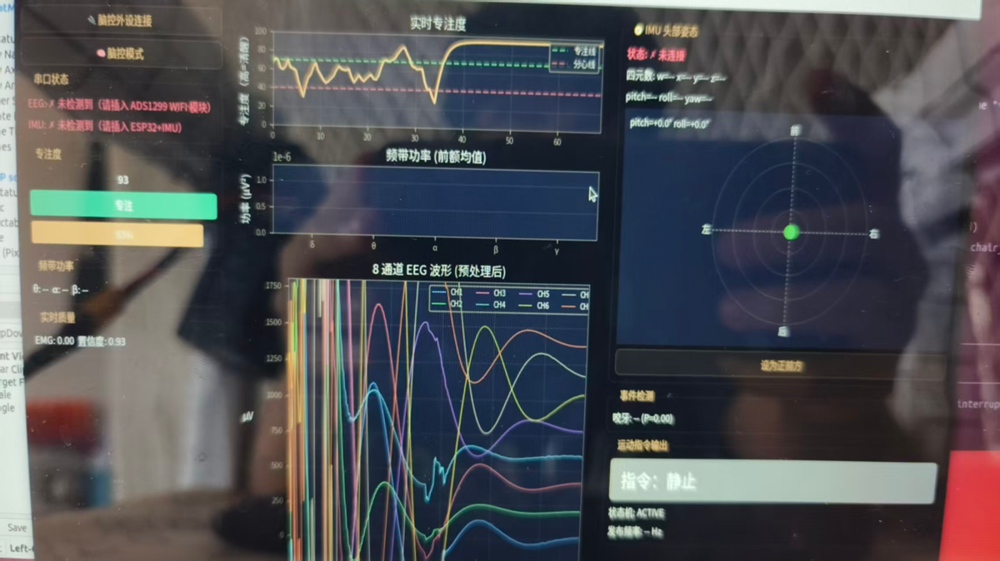
</p>
<p align="center">小智陪伴 · 脑电控制</p>

## 项目能力

| 能力 | 当前实现 | 主要入口 |
| --- | --- | --- |
| 多模态交互 | 脑电与头姿提供短时运动意图；语音发起导航、停止和状态查询；地图选点生成导航目标 | [wheelchair_app](src/wheelchair_app) |
| 离线路网导航 | 本地 OSM / NetworkX 全局规划，路径转换后交由 Nav2 `FollowPath` 与 TEB 局部规划 | [rtk_planner](src/rtk_planner)、[rtk_perception](src/rtk_perception) |
| 多源障碍感知 | N10P、LD14P 和 Gemini 深度图生成的虚拟扫描分别进入局部代价地图 | [local_costmap_params.yaml](src/rtk_perception/config/local_costmap_params.yaml) |
| 底盘指令仲裁 | 导航速度与脑控速度统一经串口节点选择、检查时效并发送到下位机 | [chassis_serial_node.py](src/rtk_perception/rtk_perception/chassis_serial_node.py) |
| 本地语音交互 | sherpa-onnx 关键词唤醒、离线 ASR、意图解析与 TTS；Kokoro / Piper 本地语音合成 | [voice_node.py](src/wheelchair_app/wheelchair_app/nodes/voice_node.py)、[ai_model_src](third_party/ai_model_src) |
| 端侧视觉推理 | YOLO11s OpenVINO IR；加载时尝试 NPU、GPU、CPU，具体设备取决于驱动与模型支持 | [yolo_engine.py](third_party/ladar_ai/src/ladar_ai/yolo_engine.py) |

默认导航链路使用仓库内的路网与本地地图瓦片，语音和视觉模型在设备上运行。首次安装依赖、下载模型或更新地图仍需要网络；可选 OSRM 模式包含公网回退配置，不能直接视为完全离线模式。

## 系统架构

界面通过 ROS 2 消息与节点交互，底盘串口由统一执行节点管理。脑控与导航的速度链路分别接入仲裁；语音发出目标或停止请求，不直接写入电机串口。

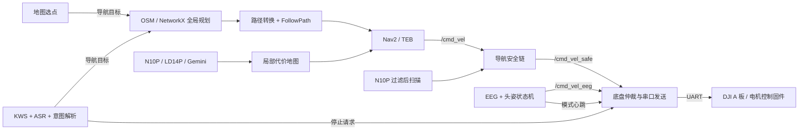

### 导航：全局路网与局部避障衔接

[data/region.graphml](data/region.graphml) 提供示例区域的本地路网。[全局规划节点](src/rtk_planner/rtk_planner/networkx_planner_node.py) 将起终点投影到邻近道路边并计算路线，[路径转换节点](src/rtk_perception/rtk_perception/path_to_baselink_node.py) 转换为车体坐标下的局部路径，再由 [path_feeder_node](src/rtk_perception/rtk_perception/path_feeder_node.py) 发送给 Nav2。

针对单点 GNSS 的位置波动，路径状态机使用 5 m 进入、4 m 退出的滞回阈值，并通过拐角锁定减少转弯时跨越近处路径点的情况。`rtk_*` 是包名；当前实物配置使用 EC20 GNSS，包名本身不代表已获得厘米级 RTK 定位。

<details>
<summary>查看路径状态机示意图</summary>

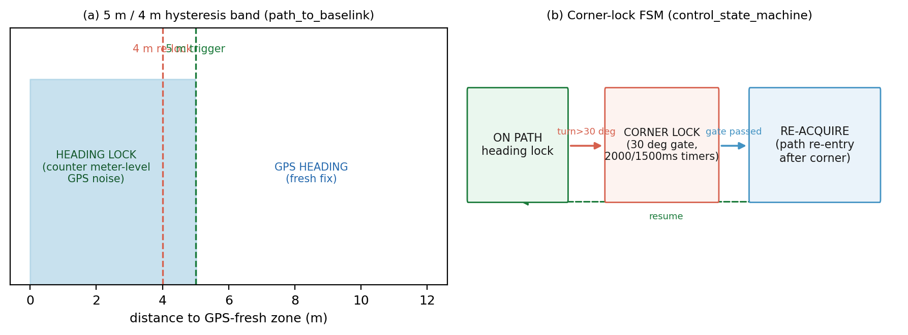

</details>

### 脑控：专注度、头姿与状态机

自制采集帽使用 ADS1299 八通道前额 EEG。脑控链路结合专注度特征、头部 IMU 俯仰 / 侧倾与咬牙确认，由 20 Hz 状态机发布运动意图；持续专注判定、切换冷却与 EEG 冻结窗口用于抑制误触发。

脑控页面以 1 Hz 发送 `/eeg_mode_active` 心跳。有效心跳表示脑控待命，最近的非零运动指令触发临时接管；超过 3 s 未收到模式心跳时撤销脑控模式。交还导航控制权后，是否运动仍由有效目标、定位、门控和速度时效共同决定。

<details>
<summary>查看专注度模型的离线评估图</summary>

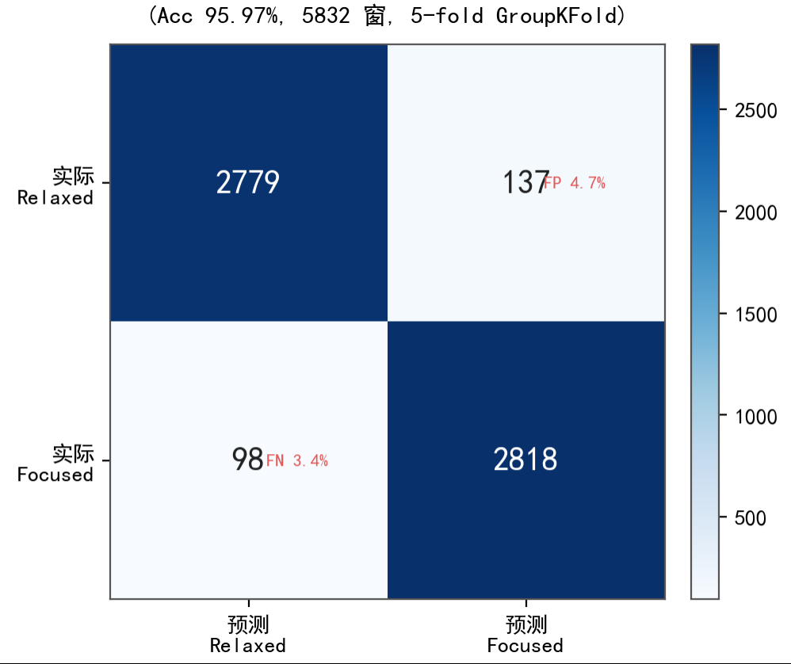

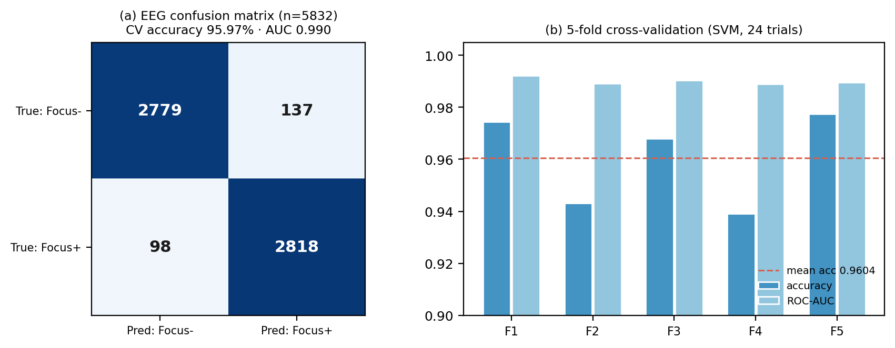

对应资源见[模型仓库](https://huggingface.co/lh527/smart-wheelchair/tree/main/models/eeg)。图中结果来自离线评估，不代表实地载人驾驶准确率。

</details>

### 执行约束与覆盖范围

| 位置 | 已实现的约束 | 覆盖范围 |
| --- | --- | --- |
| 局部代价地图 | 三路扫描独立作为观测源 | 向 Nav2 提供障碍信息；观测源数量不等于硬件安全冗余认证 |
| 导航安全链 | 20 Hz 检查 N10P 扫描与 Nav2 指令；配置的前方扇区内，障碍距离小于 0.3 m 输出零速，1.0 m 内减速；已接收数据过期 0.5 s 后输出零速 | 作用于 `/cmd_vel` → `/cmd_vel_safe`，具体值见[参数文件](src/rtk_perception/config/perception_params.yaml) |
| 底盘节点 | 启动静默、强制停车、脑控接管、导航门控、指令与定位时效检查 | 统一处理串口发送；串口断开后能否实际停车还依赖下位机和硬件 |
| 下位机 | 电机闭环与通信看门狗 | 属于独立固件仓库，不在本仓库验证范围内 |

脑控速度 `/cmd_vel_eeg` **不经过导航安全链**。安全链依赖过滤后的前方扫描，不提供全方位碰撞保护；算法对扇区内全无有效距离的扫描按无障碍处理，因此“扫描仍在更新”也不能单独证明感知有效。相关实现见 [safety_chain.py](src/rtk_perception/rtk_perception/safety_chain.py) 与 [safety_chain_node.py](src/rtk_perception/rtk_perception/safety_chain_node.py)。

## 开始使用

目标环境为 **Ubuntu 22.04 + ROS 2 Humble + Python 3.10**，原型主机为 DK2500 / 16 GB 内存。完整系统还需要底盘、定位与姿态传感器、两台雷达、Gemini 335L、音频设备；脑控功能另需 EEG 与头部 IMU。

1. 阅读[部署指南](docs/getting-started.md)，准备系统依赖、第三方 ROS 包和硬件驱动。
2. 下载模型到仓库根目录的 `models/`，核对 YOLO 路径与设备配置。
3. 按指南构建、加载环境，再选择底盘模式启动。

在已完成配置与构建的 Ubuntu 终端中，从仓库根目录执行：

```bash
source source_env.sh
# 仅将底盘、车体 IMU / GNSS 切换为模拟输入
USE_REAL_CHASSIS=0 USE_REAL_IMU=0 bash start/start_all.sh
```

这两个开关**不会关闭雷达、相机、语音或模型加载**，不是无需外设的完整仿真。启动脚本默认使用真实底盘和真实 IMU；启用真实底盘会强制启用真实 IMU。停止命令为：

```bash
bash start/stop_all.sh
```

详细的构建顺序、串口变量、日志位置、只读运行检查和当前复现限制均在[部署指南](docs/getting-started.md)中。

## 验证与项目边界

| 证据 | 可以说明什么 | 不能据此推断什么 |
| --- | --- | --- |
| [2026-06-25 自动化归档](tests/results/2026-06-25-teb/auto_test_result.txt) | 当次记录为 99 项 `rtk_perception` 单测 + 7 项振荡测试通过，核心启动和控制器生命周期检查通过 | 不代表当前提交已重新运行全部测试，也不是 106 次载人测试 |
| [同日硬件联调归档](tests/results/2026-06-25-teb/hardware_integration_test.txt) | 记录雷达、TF、costmap 数据链路与模拟底盘响应 | 记录同时保留端口冲突、当时的 action 命名问题及未完成的端到端检查 |
| [L 形路径检查流程](tests/sim_teb_l_shape_test.md) | 提供后续路径跟踪的人工验收步骤 | 该文档是检查流程，不是完成证明；旧命令需与当前配置核对 |

当前源码中的 `path_feeder_node` 已使用 `follow_path` action 名称；历史联调记录中的命名问题应作为当时的情况阅读。完整复现仍需在目标 Ubuntu / ROS 2 环境与对应外设上验证，仓库没有给出全新机器一键部署或载人运行认证结论。

## 代码导航

| 路径 | 负责内容 |
| --- | --- |
| [src/wheelchair_app](src/wheelchair_app) | PyQt5 三页面、Web 资源、脑控状态机、语音节点 |
| [src/rtk_planner](src/rtk_planner) | NetworkX / OSRM 全局规划 |
| [src/rtk_perception](src/rtk_perception) | 扫描处理、局部路径、TEB 启动、安全链、底盘仲裁与测试 |
| [src/rtk_gnss](src/rtk_gnss)、[src/rtk_imu](src/rtk_imu) | GNSS、车体姿态与定位相关启动配置 |
| [src/rtk_map](src/rtk_map)、[src/rtk_frontend](src/rtk_frontend) | 本地地图瓦片、前端服务与 ROS 桥接 |
| [src/rtk_msgs](src/rtk_msgs)、[src/rtk_bringup](src/rtk_bringup) | 自定义消息与组合启动 |
| [third_party](third_party) | TEB、雷达驱动、ladar_ai 与 ai_model 组件 |
| [data](data)、[config/region.yaml](config/region.yaml) | 示例区域路网、瓦片及地图下载范围 |
| [start](start)、[scripts](scripts) | 启停、地图准备和诊断工具 |
| [docs/images](docs/images)、[tests/results](tests/results) | 项目实物 / 界面图与历史验证记录 |

## 电控与许可

DJI A 板上的 STM32 电机闭环及看门狗固件见[电控层仓库](https://github.com/Bit-Walker/KUST-RoboMaster-DJI-A-Board/tree/V2)。上位机与下位机需要匹配串口协议、航向定义和电机参数后才能联合运行。

本仓库使用 [MIT 许可证](LICENSE)。`third_party/` 中的第三方代码、模型权重与地图数据另遵循各自许可；复用时请同时检查其来源说明。

相关项目：[Nav2](https://github.com/ros-navigation/navigation2) · [TEB Local Planner](https://github.com/rst-tu-dortmund/teb_local_planner) · [OpenVINO](https://github.com/openvinotoolkit/openvino) · [sherpa-onnx](https://github.com/k2-fsa/sherpa-onnx) · [Orbbec ROS 2 驱动](https://github.com/orbbec/OrbbecSDK_ROS2)。
